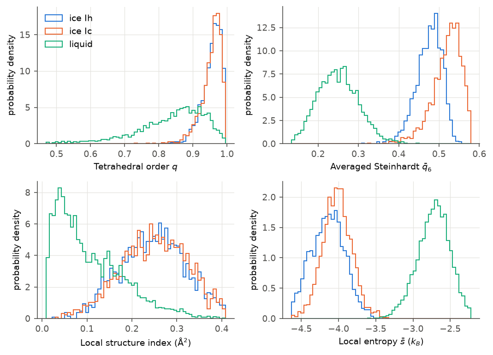

# First steps

This page computes one order parameter on one structure. Everything else in
SolOrder follows the same three steps.

## 1. Load a structure with MDAnalysis

```python
import MDAnalysis as mda

u = mda.Universe("liquid.gro")
print(u)
print(u.dimensions)        # box lengths (Å) and angles (degrees)
```

```text
<Universe with 12288 atoms>
[50.530098 50.530098 50.530098 90.       90.       90.      ]
```

An MDAnalysis `Universe` holds the atoms, the box, and (optionally) a
trajectory. SolOrder needs the **periodic box**, so files without one (a bare
`.xyz`, for example) need `u.dimensions = [Lx, Ly, Lz, 90, 90, 90]` first.

## 2. Create an `OrderParameter` object

```python
from SolOrder import OrderParameter

op = OrderParameter(u, cutoff=5.0)
print(op.n)                # number of water molecules analysed
```

```text
4096
```

`OrderParameter` takes a snapshot of one frame (the first, by default) and
works on the **oxygen atoms**. Three settings matter at this point:

| Argument | Default | Meaning |
|---|---|---|
| `cutoff` | `4.5` | neighbor search radius in Å |
| `selection` | `"name OW"` | which atoms are the water oxygens |
| `hydrogen_selection` | `"name HW1 HW2"` | which atoms are the water hydrogens |

If your file names the atoms differently (`O`/`H`, or LAMMPS types), change the
selections, for example `OrderParameter(u, selection="type 1", hydrogen_selection="type 2")`.

## 3. Compute an order parameter

```python
q = op.tetrahedral_order()
print(q.shape)
print(q[:5].round(3))
print(q.mean().round(3))
```

```text
(4096,)
[0.915 0.903 0.901 0.884 0.814]
0.834
```

The result is a NumPy array with **one value per oxygen**, in the order of
`op.atom_indices`. The tetrahedral order parameter $q$ is 1 for a perfect
tetrahedron and lower for a distorted one. Liquid water averages about 0.83.

## Compare ice and liquid

Do the same for the ice structure and plot both:

```python
import matplotlib.pyplot as plt

for name in ["ice_Ih", "liquid"]:
    q = OrderParameter(mda.Universe(f"{name}.gro")).tetrahedral_order()
    plt.hist(q, bins=60, range=(0.5, 1.0), density=True, histtype="step", label=name)

plt.xlabel("tetrahedral order q")
plt.ylabel("probability density")
plt.legend()
plt.show()
```



*The top-left panel is the plot above, with ice Ic added. The other panels show
three more parameters from the [tour](order-parameters.md).*

Almost every ice molecule has $q > 0.9$; the liquid spreads from 0.5 to 1.
The two overlap, though: a liquid molecule can momentarily look tetrahedral. No
single parameter separates the phases perfectly, which is why the next pages
combine parameters and use dedicated classifiers.

## What you learned

- `OrderParameter(u)` analyses one frame of an MDAnalysis Universe.
- Every method returns one value per water molecule as a NumPy array.
- Distances are in Å; the box must be periodic.

Next: [a tour of order parameters](order-parameters.md).
