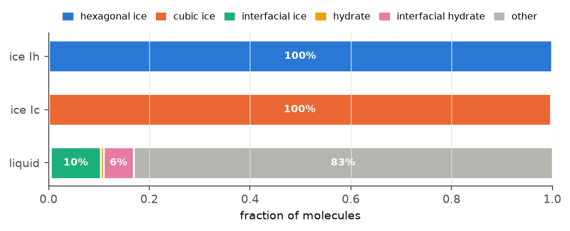
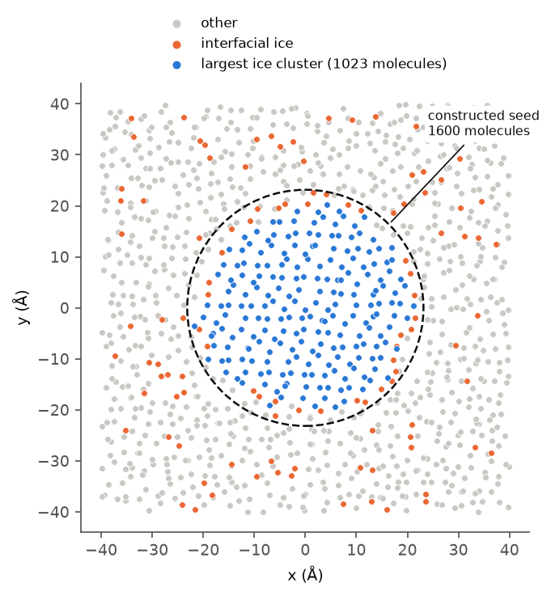

# Classifying ice

Continuous order parameters give a number per molecule. Often you want a
**label** instead: is this molecule ice Ih, ice Ic, or liquid? SolOrder has
three ready-made classifiers that need only oxygen positions and no training.

| Method | Call | Labels |
|---|---|---|
| CHILL | `op.chill()` | hexagonal, cubic, interfacial ice, other |
| CHILL+ | `op.chill_plus()` | also hydrate and interfacial hydrate |
| Polyhedral template matching | `op.template_matching()` | cubic / hexagonal diamond, other (needs `SolOrder[ptm]`) |

## CHILL+ in four lines

```python
import numpy as np
import MDAnalysis as mda
from SolOrder import OrderParameter

op = OrderParameter(mda.Universe("ice_Ic.gro"))
result = op.chill_plus()
names, counts = np.unique(result.names, return_counts=True)
print(dict(zip(names, counts)))
```

```text
{'cubic_ice': 1914, 'interfacial_ice': 6}
```

`result.labels` holds integer codes and `result.names` the matching strings:

| Code | Name |
|---|---|
| 0 | `other` |
| 1 | `hexagonal_ice` |
| 2 | `cubic_ice` |
| 3 | `interfacial_ice` |
| 4 | `hydrate` |
| 5 | `interfacial_hydrate` |

CHILL+ labels nearly every molecule of thermal ice correctly, and the polytype
too:



!!! warning "`other` is not `liquid`"
    Code 0 means "none of the ice or hydrate patterns". In the supercooled
    liquid, about 17% of molecules still get an ice or hydrate label. These are
    single molecules with a momentarily ice-like environment. That is why
    nucleus studies look at **connected clusters** of ice molecules, not at
    isolated labels.

## Template matching (optional)

Polyhedral template matching compares each oxygen's neighbors to ideal cubic
and hexagonal diamond lattices:

```python
match = op.template_matching()     # needs: pip install "SolOrder[ptm]"
print(match.type_names[6], np.mean(match.labels == 6))
```

```text
Cubic diamond 0.943
```

Codes come from OVITO: 6 is cubic diamond (ice Ic), 7 hexagonal diamond (ice
Ih), 0 other. `match.rmsd` gives the fit quality.

## Finding an ice nucleus

The file `seed.gro.gz` holds a spherical ice Ih crystal of 1600 molecules
placed in supercooled liquid, after 20 ps of dynamics. The task: find it and
measure its size.

**Step 1: label every molecule.**

```python
u = mda.Universe("seed.gro.gz")            # 32 607 oxygens, no hydrogens
op = OrderParameter(u, cutoff=3.5)
labels = op.chill_plus().labels
ice = np.isin(labels, (1, 2))              # hexagonal or cubic ice
print(ice.sum())
```

```text
1146
```

**Step 2: keep the largest connected cluster.** Two ice molecules belong to
the same cluster when they are neighbors (within 3.5 Å). The neighbor list is
already in `op`; SciPy finds the connected groups:

```python
from scipy.sparse import coo_matrix
from scipy.sparse.csgraph import connected_components

graph = op.neighbor_list()                         # neighbors within 3.5 Å
source = np.repeat(np.arange(op.n), graph.counts)  # first atom of every pair
both_ice = ice[source] & ice[graph.indices]
adjacency = coo_matrix((np.ones(both_ice.sum()), (source[both_ice], graph.indices[both_ice])),
                       shape=(op.n, op.n))
_, cluster = connected_components(adjacency, directed=False)

sizes = np.bincount(cluster[ice])
print("largest cluster:", sizes.max(), "molecules")
```

```text
largest cluster: 1023 molecules
```

The other 123 ice-labelled molecules are scattered through the liquid in small
groups; step 2 keeps them out of the nucleus.



*A 6 Å thick slice through the centre. The dashed circle is the crystal that
was placed; blue molecules belong to the largest ice cluster.*

!!! info "Why 1023 and not 1600?"
    The crystal's outermost layer of molecules has neighbors on the liquid side,
    so it does not look like perfect ice, and CHILL+ labels it `interfacial_ice`
    or `other`. Every local classifier misses a surface shell of a few Å, so the
    detected cluster is always **smaller** than the crystal, and the shortfall
    grows as the crystal gets smaller. Report which classifier and clustering
    rule you used, and do not compare raw nucleus sizes across methods. The
    `benchmarks/nucleus_size.py` module in the repository shows how to calibrate
    and correct for this shell.

You can check the result against the stored truth:

```python
truth = np.load("seed_truth.npz")
in_cluster = ice & (cluster == np.argmax(sizes))
print("placed:", truth["seed"].sum(), " found:", in_cluster.sum(),
      " found inside the placed crystal:", (in_cluster & truth["seed"]).sum())
```

```text
placed: 1600  found: 1023  found inside the placed crystal: 1023
```

Next: [choosing a parameter](choosing-a-parameter.md).
