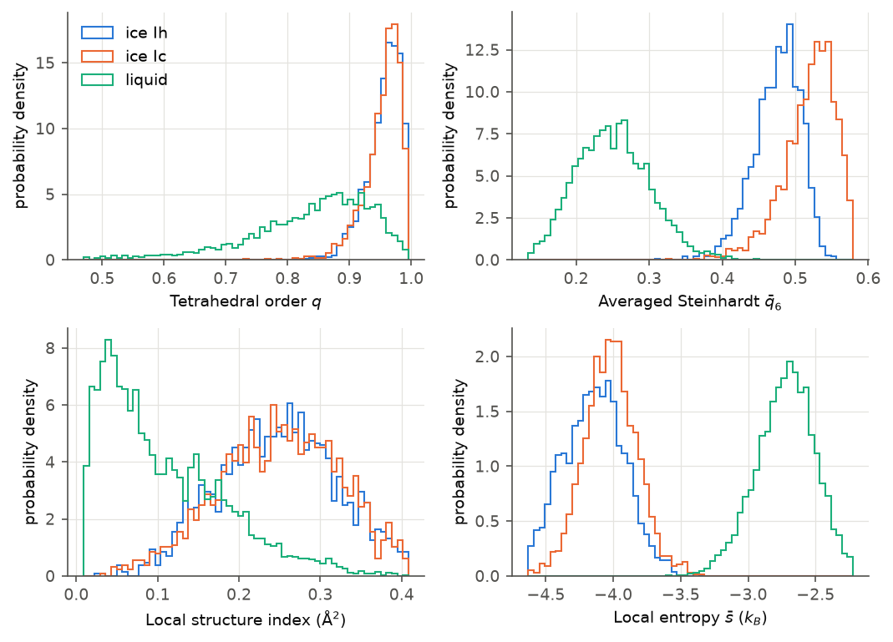
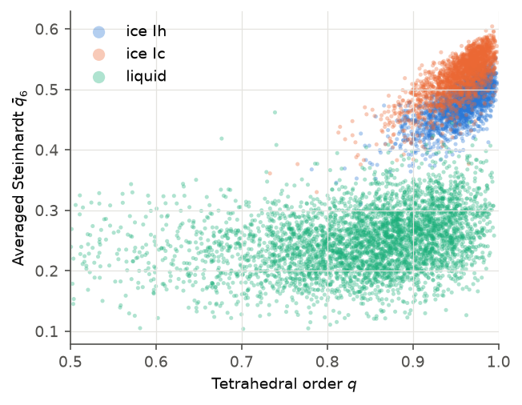

# A tour of order parameters

An order parameter turns a molecule's local environment into a number. This page
tours the most common ones, computes each on ice Ih, ice Ic and liquid water, and
shows what they can and cannot tell apart.

All examples start from:

```python
import numpy as np
import MDAnalysis as mda
from SolOrder import OrderParameter, eFingerprint

u = mda.Universe("ice_Ih.gro")
op = OrderParameter(u, cutoff=5.0)
```

## Counting neighbors

The simplest question: how many molecules are close by?

```python
cn = op.coordination_number(cutoff=3.5)   # neighbors within 3.5 Å
d5 = op.d5()                              # distance to the 5th-nearest neighbor (Å)
lsi = op.local_structure_index()          # local structure index (Ų)
```

- **Coordination number** counts oxygens within a cutoff. In ice every molecule
  has exactly 4 hydrogen-bonded neighbors; liquid water has a little more than 4,
  because extra molecules intrude between the shells.
- **$d_5$** is the distance to the fifth neighbor. Ice keeps it far away
  (about 4.1 Å); in the liquid it moves in (about 3.7 Å).
- **LSI** measures how cleanly the first shell is separated from the second.
  High in ice, low in the liquid.

## Tetrahedral order

Water likes four neighbors at the corners of a tetrahedron. The **orientational
tetrahedral order** $q$ measures how close the four nearest neighbors are to
that ideal:

$$
q = 1 - \frac{3}{8}\sum_{j=1}^{3}\sum_{k=j+1}^{4}\left(\cos\psi_{jk} + \tfrac{1}{3}\right)^2
$$

where $\psi_{jk}$ is the angle between neighbors $j$ and $k$ seen from the
central oxygen. $q = 1$ for a perfect tetrahedron.

```python
q = op.tetrahedral_order()
q_avg = op.tetrahedral_order(averaged=True)   # averaged over the molecule and its neighbors
```

## Bond-orientational (Steinhardt) order

Steinhardt parameters describe the *pattern* of neighbor directions using
spherical harmonics of degree $l$. The per-molecule $q_l$ is noisy; the
**averaged** $\bar q_l$ (Lechner–Dellago) averages over the neighbors first and
separates phases much better.

```python
q6 = op.steinhardt(l=6, cutoff=3.5)
q6_avg = op.steinhardt(l=6, averaged=True, cutoff=3.5)
q3_avg = op.steinhardt(l=3, averaged=True, cutoff=3.5)
```

$\bar q_6$ is one of the few simple parameters that separates **ice Ih from ice
Ic** (see the figure below), not only ice from liquid.

## Hydrogen bonds

These use the hydrogen positions as well as the oxygens.

```python
hb = op.hydrogen_bonds()        # O–O ≤ 3.5 Å and H–O···O angle < 30°
print(hb.total.mean())          # donated + accepted per molecule
zeta = op.zeta()                # gap between the H-bonded and the first non-H-bonded neighbor (Å)
```

In ice every molecule donates two and accepts two hydrogen bonds (total 4).
$\zeta$ is large in ice (about 1.2 Å) and smaller in the liquid.

## Entropy fingerprint

The pair-entropy fingerprint projects the two-body entropy onto each molecule;
its local average $\bar s$ is a sharp ice/liquid separator. Lower means more
ordered. It has its own class:

```python
entropy = eFingerprint(u, cutoff=5.0)
s = entropy.Entropy()            # per molecule, units of k_B
s_avg = entropy.localEntropy()   # averaged over neighbors
```

## Results side by side

Mean values on the three example structures (220 K):

| Parameter | Call | ice Ih | ice Ic | liquid |
|---|---|---|---|---|
| Coordination number | `coordination_number(3.5)` | 4.00 | 4.00 | 4.30 |
| $d_5$ (Å) | `d5()` | 4.10 | 4.10 | 3.68 |
| LSI (Ų) | `local_structure_index()` | 0.249 | 0.251 | 0.107 |
| Tetrahedral order $q$ | `tetrahedral_order()` | 0.956 | 0.955 | 0.834 |
| $\bar q_3$ | `steinhardt(3, averaged=True, cutoff=3.5)` | 0.332 | 0.425 | 0.207 |
| $\bar q_6$ | `steinhardt(6, averaged=True, cutoff=3.5)` | 0.476 | 0.521 | 0.250 |
| Hydrogen bonds | `hydrogen_bonds().total` | 4.00 | 4.00 | 3.97 |
| $\zeta$ (Å) | `zeta()` | 1.20 | 1.20 | 0.74 |
| Local entropy $\bar s$ ($k_B$) | `eFingerprint(u).localEntropy()` | −4.15 | −4.02 | −2.72 |

To reproduce a row:

```python
for name in ["ice_Ih", "ice_Ic", "liquid"]:
    op = OrderParameter(mda.Universe(f"{name}.gro"), cutoff=5.0)
    print(name, round(np.nanmean(op.d5()), 2))
```

```text
ice_Ih 4.1
ice_Ic 4.1
liquid 3.68
```

!!! tip "Means hide the overlap"
    A difference in means does not make a good classifier. Always look at the
    full distributions: the tails decide how many molecules get the wrong label.



The two ices are nearly identical in $q$, LSI and $\bar s$: these parameters see
the local tetrahedron, which is the same in both. $\bar q_6$ (top right) reaches
further and splits them, partly.

## Combining two parameters

Plotting two parameters against each other often separates what one cannot:

```python
import matplotlib.pyplot as plt

for name in ["ice_Ih", "ice_Ic", "liquid"]:
    op = OrderParameter(mda.Universe(f"{name}.gro"), cutoff=5.0)
    plt.scatter(op.tetrahedral_order(), op.steinhardt(6, averaged=True, cutoff=3.5),
                s=4, alpha=0.3, label=name)
plt.xlabel("q")
plt.ylabel("averaged q6")
plt.legend()
plt.show()
```



The liquid sits low in $\bar q_6$ whatever its $q$. The ices form a compact
cloud at high $q$ and high $\bar q_6$, with ice Ic shifted slightly up.

## More parameters

SolOrder implements many more: Voronoi volumes, centrosymmetry, angular
distributions, ring statistics, SOAP and other descriptors. See
[Extended parameters](../extended_parameters.md) and the
[Core parameters reference](../order_parameters.md).

Next: [classifying ice](ice-classification.md).
