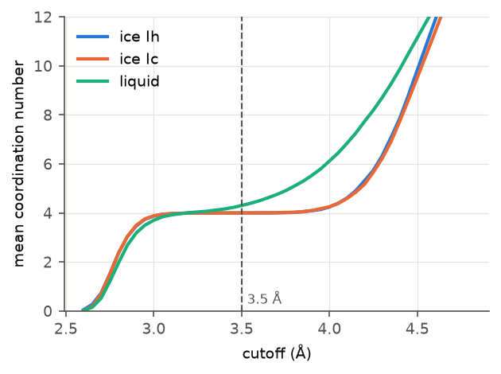

# Tips and common mistakes

The examples on this page start from:

```python
import numpy as np
import MDAnalysis as mda
from SolOrder import OrderParameter

u = mda.Universe("liquid.gro")
op = OrderParameter(u, cutoff=5.0)
```

## Units

| Quantity | Unit |
|---|---|
| distances, cutoffs, $d_5$, $\zeta$ | Å |
| LSI | Ų |
| density from `op.density()` | molecules per ų (a **number** density, not g/cm³) |
| entropy fingerprints | $k_B$ |
| angles | degrees for inputs (`hydrogen_bonds(angle=30)`), radians in angle distributions |

MDAnalysis converts every file format to Å on reading, so you never convert
units yourself.

## Choosing a cutoff

`OrderParameter(u, cutoff=...)` sets the **neighbor search radius**. Methods
that use the nearest *k* neighbors (tetrahedral order, $d_5$) only need it to be
large enough to contain them; methods that use *all* neighbors inside a radius
(coordination number, Steinhardt, CHILL+) depend on it directly. Those methods
take their own `cutoff=` argument.

For water, 3.5 Å is the standard first-shell cutoff. It sits on the plateau
between the first and second neighbor shells, where the result hardly depends
on the exact value:

```python
for c in (3.0, 3.5, 4.0):
    print(c, op.coordination_number(cutoff=c).mean().round(2))
```

```text
3.0 3.7
3.5 4.3
4.0 6.12
```



The plateau at 4 neighbors is flat for ice and only a slope for the liquid.
Test the sensitivity of your own result by repeating it at a slightly
different cutoff.

## NaN values

SolOrder returns `NaN` instead of a misleading number when a molecule lacks the
neighbors a definition needs. For example, $d_5$ is NaN when fewer than five
neighbors lie within the search cutoff:

```python
op_small = OrderParameter(u, cutoff=3.0)
print(np.isnan(op_small.d5()).mean())   # 1.0: no fifth neighbor within 3 Å
```

The fix is a larger `cutoff`. Use `np.nanmean` and `np.nanpercentile` when
averaging, and count the NaNs: many NaNs mean the cutoff is too small.

## Atom names

The default selections are `"name OW"` and `"name HW1 HW2"` (GROMACS naming).
Other files need other selections:

```python
# LAMMPS data file with types: 1 = O, 2 = H
op = OrderParameter(u, selection="type 1", hydrogen_selection="type 2")

# PDB-style names
op = OrderParameter(u, selection="name O", hydrogen_selection="name H1 H2")
```

Parameters that use hydrogens (hydrogen bonds, $\zeta$, F4) require exactly one
oxygen and two hydrogens per residue. Oxygen-only files work for everything
else, including CHILL+.

## Four-site water models

TIP4P-type models have a massless charge site (`MW`). Leave it out of both
selections. The defaults already do.

## Coarse-grained (mW) water

The mW model has one bead per molecule. Select the beads as the "oxygens" and
use oxygen-only parameters. The neighbor distances differ slightly from atomistic
water, so check your cutoffs with the plot above.

## Comparing results

- **State every setting**: parameter, cutoff, averaging, thresholds. Small
  changes move the distributions noticeably.
- **Look at distributions, not means.** Overlapping tails decide
  classification errors.
- **Nucleus sizes depend on the method.** Different classifiers miss different
  amounts of the crystal surface (see [Classifying ice](ice-classification.md)),
  so raw sizes from different methods are not comparable.

## Getting help

- Method details and conventions: [Core parameters](../order_parameters.md) and
  [Extended parameters](../extended_parameters.md).
- Bugs and questions: [GitHub issues](https://github.com/dmighty007/SolOrder/issues).
