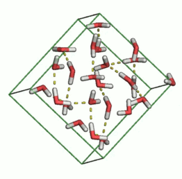

# SolOrder



SolOrder computes **local structural order parameters** for water in molecular
dynamics simulations. It gives every water molecule a number, or a label, that
describes how ordered its surroundings are. That is how you tell ice from liquid,
ice Ih from ice Ic, or find a growing ice nucleus in a supercooled liquid.

```python
import MDAnalysis as mda
from SolOrder import OrderParameter

u = mda.Universe("ice_Ih.gro")
op = OrderParameter(u)
q = op.tetrahedral_order()     # one value per water molecule
```

## What it can compute

| Family | Examples | Section |
|---|---|---|
| Neighbor geometry | coordination number, $d_5$, LSI, tetrahedral order $q$, $S_k$ | [Tour](guide/order-parameters.md) |
| Bond-orientational order | Steinhardt $q_l$, $w_l$, averaged $\bar q_l$, crystalline connections | [Tour](guide/order-parameters.md) |
| Hydrogen bonds | donated/accepted counts, $\zeta$, F4 torsion, ring statistics | [Tour](guide/order-parameters.md) |
| Entropy | pair-entropy fingerprint $s$ and its local average $\bar s$ | [Tour](guide/order-parameters.md) |
| Ice classifiers | CHILL, CHILL+, polyhedral template matching | [Classifying ice](guide/ice-classification.md) |
| Geometry and descriptors | Voronoi cells, centrosymmetry, SOAP, ACSF and more | [Extended parameters](extended_parameters.md) |

## Where to start

New to SolOrder? Read the **beginner's guide** in order:

1. [Installation](guide/installation.md): install the package and get the example files.
2. [First steps](guide/first-steps.md): load a structure and compute your first order parameter.
3. [A tour of order parameters](guide/order-parameters.md): what the common parameters measure and how they separate ice from liquid.
4. [Classifying ice](guide/ice-classification.md): label molecules with CHILL+ and measure an ice nucleus.
5. [Choosing a parameter](guide/choosing-a-parameter.md): which parameter answers which question, and how to test a choice.
6. [Working with trajectories](guide/trajectories.md): loop over frames and run in parallel.
7. [Tips and common mistakes](guide/tips.md): units, cutoffs, NaN values and other pitfalls.

Every example runs on the small structures in `docs/guide/data/`, and the
test suite checks that each one still prints what the page shows.

The **Reference** section lists every class and method
([analysis classes](api/analysis.md), [result types](api/results.md)) and
documents the conventions and units of each parameter.
