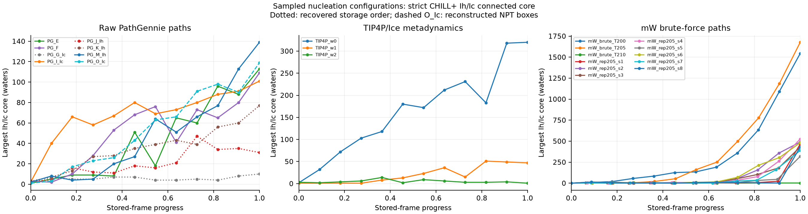
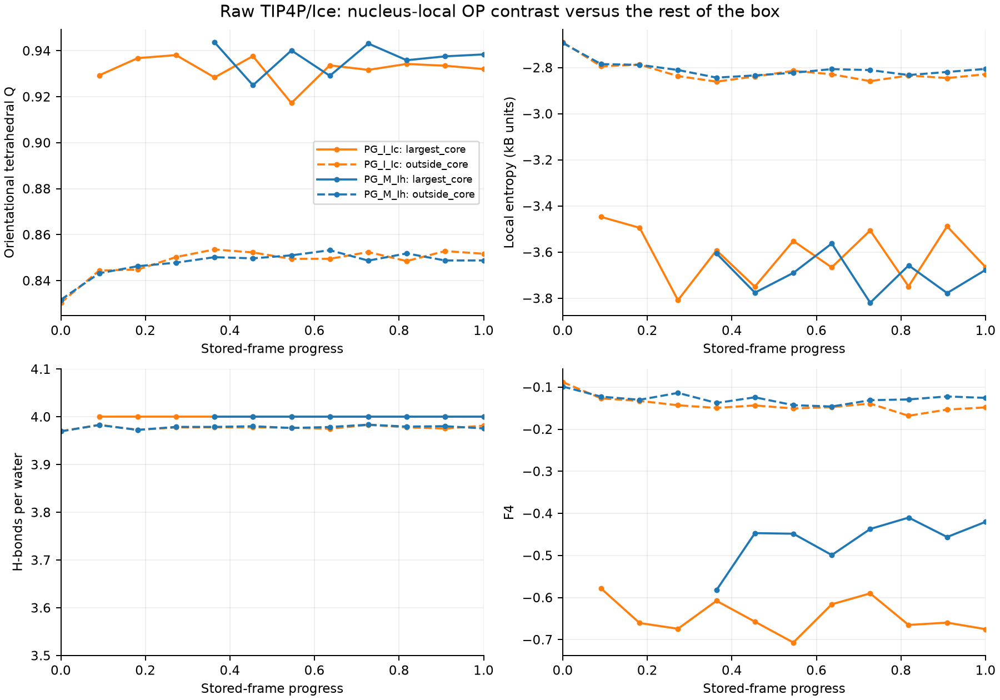
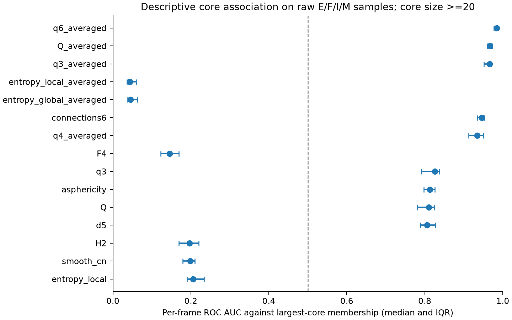

# Validation on nucleation configurations

**366 sampled frames from 44 trajectories / path files**
were analyzed from `/home/dm/Dibyendu/Projects/ice_nucleation_pg`. This is a deterministic sampled
validation run, not an exhaustive calculation of every stored frame.
The analyzed configurations contain 1,220,496 oxygen-center instances.

| Dataset family | Sources | Sampled frames | Oxygen-center instances |
|---|---:|---:|---:|
| PathGennie_raw | 8 | 96 | 393,216 |
| metadynamics | 3 | 36 | 36,000 |
| MD_shooting | 18 | 54 | 54,000 |
| mW_bruteforce | 11 | 132 | 540,672 |
| PathGennie_quenched | 4 | 48 | 196,608 |

## Numerical checks

- Frames with failed checks: **0**.
- Input coordinates and periodic boxes were verified after MDAnalysis precision
  conversion before calculation; coordinates were rechecked after OP calls.
- Independent project CHILL+ mismatches: **0** centers.
- Independent cKDTree coordination mismatches: **0** centers.
- Independent donor-H-acceptor H-bond count mismatches: **0** centers
  across 186 full-atom snapshots.
- Serial/parallel comparison: one complete snapshot per source (44 snapshots);
  maximum absolute per-center difference **0**.
- Maximum relative Voronoi volume-conservation error: **7.51e-08**.
- Infinite OP outputs: **0**. NaN outputs (centers lacking the
  neighbors a parameter needs): **0**; per-parameter counts are in frames.csv.

The independent CHILL+ reference is the source project's `lib/order.py`, using
an explicit harmonic polynomial implementation and cKDTree neighbor search.
SolOrder uses SciPy spherical harmonics, MDAnalysis geometry, and Numba reductions.
The reference was evaluated on the same analysis coordinate precision and box.
This checks implementation agreement; it does not supply independent experimental
phase labels. Selected coordinate/box hashes, source file sizes and timestamps,
package versions and source-reference hash are in [manifest.json](manifest.json).

## Raw PathGennie paths

| Path | Samples / stored frames | Largest core: first -> last | Maximum sampled core | Mean Q: first -> last |
|---|---:|---:|---:|---:|
| PG_E | 12 / 1775 | 1 -> 113 | 113 | 0.8295 -> 0.8500 |
| PG_F | 12 / 2647 | 3 -> 109 | 109 | 0.8291 -> 0.8524 |
| PG_G_Ic (recovered storage order) | 12 / 1920 | 1 -> 10 | 10 | 0.8305 -> 0.8485 |
| PG_I_Ic | 12 / 2933 | 2 -> 101 | 101 | 0.8304 -> 0.8537 |
| PG_J_Ih (recovered storage order) | 12 / 4767 | 3 -> 31 | 47 | 0.8309 -> 0.8558 |
| PG_K_Ih (recovered storage order) | 12 / 2302 | 3 -> 77 | 77 | 0.8309 -> 0.8520 |
| PG_M_Ih | 12 / 6402 | 2 -> 139 | 139 | 0.8318 -> 0.8518 |
| PG_O_Ic (approximate NPT boxes) | 12 / 3191 | 1 -> 119 | 119 | 0.8390 -> 0.8709 |



Stored-frame progress is normalized independently per source. PathGennie accepted
paths and metadynamics are selected/biased ensembles; these curves are not an
unbiased nucleation rate or a common physical clock. Native MD/NPZ times are
preserved in the CSV where available. Shooting branches and all individual
sources are listed in [source_summary.csv](source_summary.csv).

## Local OP contrast



Core membership means the largest connected set of CHILL+ Ih/Ic centers, using
3.5-Angstrom O--O edges; interface labels are excluded from this strict core.
Outside-core averages include every remaining center. Tiny cores (<20 waters)
are omitted from the plotted core mean to avoid interpreting single random
ice-like molecules as a nucleus.

The following table summarizes signed ROC AUC against that core-membership mask
on readable fixed-box raw E/F/I/M path samples with cores of at least 20 waters.
Values above 0.5 indicate larger OP values inside the core; below 0.5 indicate
smaller values. Values are medians over frames, not pooled atom counts. This is
a descriptive association to a geometry-derived label, not held-out predictive
accuracy or independent phase-identification ground truth.

The label is not independent of every parameter. CHILL+ is built from q3
bond-orientational correlations over 3.5-Angstrom neighbors and labels only
four-coordinated centers, so high scores for averaged q3 (and, less directly,
other averaged bond-order parameters and crystalline connections) partly
restate the label, and coordination-based scores are constrained by it.
Parameter rankings against independent ground truth come from constructed
seeds instead (benchmarks/, seed test).

The table lists the 15 parameters with the largest median separation from
0.5, in order and without omissions.

| OP | Frames | Median AUC | Interquartile range |
|---|---:|---:|---:|
| q6_averaged | 34 | 0.985 | 0.977–0.988 |
| Q_averaged | 34 | 0.967 | 0.960–0.973 |
| q3_averaged | 34 | 0.967 | 0.952–0.970 |
| entropy_local_averaged | 34 | 0.043 | 0.036–0.060 |
| entropy_global_averaged | 34 | 0.045 | 0.038–0.063 |
| connections6 | 34 | 0.946 | 0.935–0.953 |
| q4_averaged | 34 | 0.934 | 0.912–0.949 |
| F4 | 34 | 0.145 | 0.122–0.169 |
| q3 | 34 | 0.826 | 0.791–0.838 |
| asphericity | 34 | 0.813 | 0.797–0.826 |
| Q | 34 | 0.810 | 0.781–0.824 |
| d5 | 34 | 0.806 | 0.788–0.826 |
| H2 | 34 | 0.197 | 0.170–0.221 |
| smooth_cn | 34 | 0.199 | 0.179–0.210 |
| entropy_local | 34 | 0.206 | 0.190–0.234 |



Averaged q6 and averaged tetrahedral order show strong positive core association,
while averaged entropy is lower in the core. H-bond counts are nearly four in
both populations and show little ranking separation here (median AUC about
0.51). CHILL+ itself requires four-coordination, so this is a conditional result
on these selected configurations.

Full rankings are in [core_contrast.csv](core_contrast.csv). Near-constant model
moments, such as Q_T for rigid TIP4P/Ice, are not expected to distinguish lattice
order. Global OP averages can change little when the nucleus contains only a
small fraction of the simulation box.

## Independent numerical spot checks

22 endpoint snapshots were additionally audited against separate numerical
references; **22/22 passed**. Non-averaged q3/q4/q6
agreed with the double-precision Legendre addition formula within 2.33e-15.
Direct tetrahedral, radial and LSI formulas agreed within
3.33e-16.
Independent MDAnalysis torsions/angles agreed with F4 and P(theta) within
5.52e-07.

Freud 3.4 bond-order comparisons differed by up to 6.46e-05;
these backend comparisons use an explicit 1e-4 absolute tolerance. Direct
geometric formula checks use 1e-10, Legendre checks 1e-7, and angle/torsion
checks 1e-6. Backend differences are reported rather than treated as exact
agreement. See [independent_audits.csv](independent_audits.csv).

## Coverage and limits

All 25 original calculations are evaluated on full-atom TIP4P/Ice inputs,
including local/global entropy variants, raw/normalized bond order, both CHILL
classifiers, Voronoi metrics, and the complete water-angle distribution.
Additional A/B/H parameters and geometry-derived TIP4P/Ice Q_T are also evaluated.
H-bonds, F4, water-H angles and Q_T are excluded from mW and oxygen-only movie
inputs because those inputs contain no hydrogens. The validation script does
not infer or synthesize hydrogen positions. Optional DScribe/PTM descriptors
were validated separately; this run focuses on structural OPs.

Periodic dimensions come from native DCD/NPZ metadata, the documented NVT box,
or the following explicitly approximate NPT source. Entropy spheres fit inside
half the smallest periodic height. Default OP search cutoff is 5 A; first-shell
coordination, CHILL+, F4 and bond-order comparisons use 3.5 A.

### Checkpoint and preprocessing caveats

- G/J/K checkpoint object headers are unreadable through HDF5. Complete, bounded
  zlib coordinate streams were recovered read-only, in the same physical-storage
  convention used by the source project. Logical HDF5 order and exact accepted
  path history are not guaranteed for those recovered inputs. Input files were
  not repaired or modified.
- O_Ic checkpoints contain no per-frame boxes. The source project's movie-info
  boxes were reconstructed as cycle-window medians; they are used and flagged
  as approximate, with no fallback to the NVT box. The results are not an exact
  NPT box/trajectory validation.
- Prepared movie files are FIRE-quenched, oxygen-only, and resampled. They are
  reported as a separate family. Some movies describe earlier checkpoints;
  they must not be interpreted as exactly paired thermal/quenched trajectories.
- Older duplicate checkpoints, seed-test/training arrays, and unrelated bulk
  controls are excluded. The mW T215/T220/T225 directories contain CV logs but no
  local coordinate trajectories, so no OP calculation is claimed for them.
- Finite sampling may miss transient maxima. No kinetic rate, critical nucleus
  size or universal OP threshold is estimated here.
- PG_K_Ih: recovered 2302 complete coordinate chunks versus 2303 frames in the saved movie-info table (1 fewer).

## Reproduction and artifacts

```sh
python -m pip install -e ".[validation]"
MPLCONFIGDIR=/tmp/solorder-mpl OPENBLAS_NUM_THREADS=1 OMP_NUM_THREADS=1 \
  python scripts/validate_nucleation.py \
  --data-root /home/dm/Dibyendu/Projects/ice_nucleation_pg
MPLCONFIGDIR=/tmp/solorder-mpl python scripts/audit_nucleation.py
MPLCONFIGDIR=/tmp/solorder-mpl python scripts/report_nucleation.py
```

- [Frame-level means, standard deviations, NaN counts and association scores](frames.csv)
- [Per-core/outside-core statistics](phase_conditioned.csv)
- [Independent checks per frame](checks.csv)
- [All source summaries](source_summary.csv)
- [Input provenance and selected-frame hashes](manifest.json)
- Standalone figures: [core evolution](core_evolution.pdf),
  [local OP contrast](core_op_contrast.pdf), [core association](core_association.pdf).
